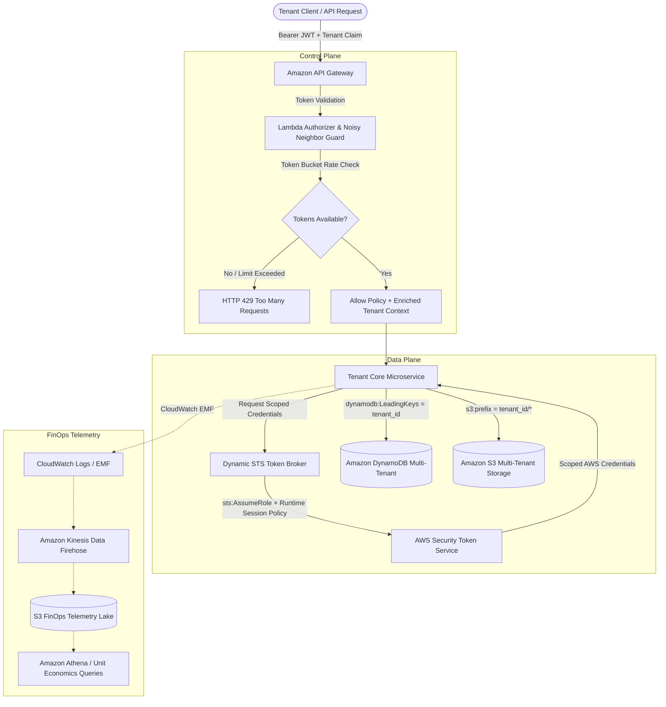

# Enterprise Multi-Tenant SaaS Platform Blueprint
### Production-Grade AWS SaaS Factory Reference Architecture

[](https://aws.amazon.com/solutions/saas-factory/)
[](https://www.terraform.io/)
[](https://www.python.org/)
[](LICENSE)
[](tests/)

An enterprise-grade **Solutions Architecture Blueprint** implementing the **AWS SaaS Factory** architecture. Solves the 4 hardest engineering challenges in multi-tenant cloud platforms: **runtime data isolation (ABAC)**, **noisy neighbor protection (tiered QoS)**, **dynamic tenant lifecycle onboarding (Silo vs. Pool)**, and **FinOps unit economics (Cost-per-Tenant)**.

---

## 🏛️ System Architecture



---

## ⚡ The 4 Core Architectural Pillars

### 1. Dynamic STS Token Broker & ABAC Data Isolation
* **The Problem**: Traditional systems rely on application developers writing `WHERE tenant_id = '...'` in queries. A single omitted clause leaks confidential data across tenants.
* **The Solution**: Application code does not access data directly. The **Token Broker** calls `sts:AssumeRole` with a dynamic runtime **Session Policy** that enforces `dynamodb:LeadingKeys` and S3 object prefixes at the AWS IAM control plane level.
* **Mathematical Security**: Even if the application attempts to read a record belonging to another tenant, AWS IAM immediately throws `AccessDeniedException`.

```python
# Generated dynamically at runtime per tenant request
session_policy = {
    "Version": "2012-10-17",
    "Statement": [{
        "Effect": "Allow",
        "Action": ["dynamodb:GetItem", "dynamodb:PutItem", "dynamodb:Query"],
        "Resource": "arn:aws:dynamodb:*:*:table/MultiTenantDataStore",
        "Condition": {
            "ForAllValues:StringEquals": {
                "dynamodb:LeadingKeys": [tenant_id]
            }
        }
    }]
}
```

### 2. Tiered API Gateway & Noisy Neighbor Guard
* **The Problem**: A Free Tier customer running an unoptimized loop can overwhelm downstream databases and cause latency spikes for paying enterprise customers.
* **The Solution**: Millisecond-precision **Token Bucket Rate Limiter** inside the Lambda Authorizer:
  * **FREE**: 10 req/s, Burst: 20 tokens, Quota: 1,000/day
  * **PRO**: 100 req/s, Burst: 250 tokens, Quota: 100,000/day
  * **ENTERPRISE**: 1,000 req/s, Burst: 2,500 tokens, Quota: 10,000,000/day

### 3. Tenant Onboarding Saga (Silo vs. Pool Matrix)
* Automated lifecycle orchestration via **AWS Step Functions** and **EventBridge**:
  * **Pooled Model (Free / Pro)**: Allocates shared logical partition space and usage plan keys. Zero infrastructure overhead.
  * **Silo Model (Enterprise / Regulated)**: Provisions dedicated AWS KMS Customer Managed Keys (CMK), dedicated S3 buckets, and dedicated DynamoDB tables with compensating transaction rollback.

### 4. SaaS FinOps & Unit Economics Engine
* Uses **CloudWatch Embedded Metric Format (EMF)** for zero-latency telemetry.
* Tracks `ExecutionDurationMs`, `MemoryMB`, `DynamoDB_RCU/WCU`, and `S3BytesTransferred` per tenant.
* Evaluates exact infrastructure cost vs. subscription revenue to identify **loss-making or abusive tenants**.

---

## 📊 Live Interactive Simulation

The repository includes a simulation suite demonstrating all 4 pillars end-to-end:

```bash
make demo
```

### Simulation Output:
```text
===========================================================================
>>> PHASE 1: Tenant Onboarding Saga (Silo vs. Pool Matrix)
===========================================================================
[1.1] Onboarding Pro Tier Tenant (Pooled Model)...
✓ Successfully Onboarded: t-cloudnova-commerce
  • Isolation Model: POOLED
  • Partition Space: t-cloudnova-commerce
  • S3 Logical Prefix: s3://saas-pooled-storage/t-cloudnova-commerce/

[1.2] Onboarding Enterprise Tier Tenant (Silo Model)...
✓ Successfully Onboarded: t-apex-global-bank
  • Isolation Model: SILO
  • Dedicated KMS CMK: alias/tenant-t-apex-global-bank
  • Dedicated S3 Bucket: saas-silo-storage-t-apex-global-bank
  • Dedicated DynamoDB: saas_orders_t-apex-global-bank

===========================================================================
>>> PHASE 2: Noisy Neighbor Guard & Tiered Token Bucket Limiter
===========================================================================
[2.1] Simulating Noisy Neighbor Attack from Free Tenant (t-startup-free)
  Triggering 35 rapid concurrent requests (Limit: 20 burst tokens)...
  ✓ Allowed Requests: 20 / 35
  ✗ Throttled (HTTP 429): 15 / 35 (Noisy Neighbor Guard Engaged!)

[2.2] High-Volume Enterprise Request Traffic (t-apex-bank)
  Triggering 150 requests under Enterprise Tier (Capacity: 2,500 burst)...
  ✓ Enterprise Throughput: 150/150 requests completed without latency (%100 SLA).

===========================================================================
>>> PHASE 3: Dynamic STS Token Broker & ABAC LeadingKeys Verification
===========================================================================
[3.1] Dynamic Runtime IAM Session Policy for t-cloudnova-inc:
  • Condition LeadingKeys: ['t-cloudnova-inc']
  • S3 Resource Prefix:    arn:aws:s3:::saas-pooled-storage/t-cloudnova-inc/*

[3.2] Validating Cross-Tenant Data Leakage Prevention:
  Attacker Tenant: t-hacker-corp -> Attempting to read: t-cloudnova-inc DynamoDB partition...
  ACCESS DENIED BY AWS IAM (LeadingKeys Mismatch)!
  ✓ Security Guarantee: Cross-tenant access mathematically blocked at the AWS control plane.

===========================================================================
>>> PHASE 4: SaaS FinOps Unit Economics & Profitability Analytics
===========================================================================
TENANT ID            TIER         REQUESTS   REVENUE    INFRA COST   NET MARGIN   MARGIN %   STATUS
-----------------------------------------------------------------------------------------------
t-cloudnova-inc      PRO          145000     $99.00     $0.4789      $98.52         99.5%   PROFITABLE
t-apex-bank          ENTERPRISE   850000     $999.00    $6.8075      $992.19        99.3%   PROFITABLE
t-unpaid-scraper     FREE         95000      $0.00      $1.3378      $-1.34       -100.0%   LOSS-MAKER
-----------------------------------------------------------------------------------------------
Total Monthly Subscription Revenue: $1098.00
Total AWS Infrastructure Spend:      $8.6242
Flagged Unprofitable Accounts:       1
```

---

## 📁 Repository Structure

```tree
aws-saas-factory-platform/
├── infra/
│   └── terraform/
│       ├── main.tf                     # Root Terraform module
│       ├── variables.tf                # Environment & region inputs
│       ├── outputs.tf                  # Infrastructure outputs
│       └── modules/
│           ├── auth/                   # Cognito User Pool & Custom Claims
│           ├── api/                    # API Gateway & Tiered Usage Plans
│           ├── isolation/              # DynamoDB LeadingKeys & S3 Storage
│           ├── onboarding/             # Step Functions & EventBridge Saga
│           └── metering/               # CloudWatch EMF & Athena FinOps
├── services/
│   ├── authorizer/                     # Lambda Authorizer & Token Bucket
│   ├── token_broker/                   # Dynamic STS Scoped Credential Broker
│   ├── tenant_api/                     # Multi-Tenant Business Microservice
│   └── onboarding/                     # Step Functions Onboarding Handlers
├── metering/
│   └── finops/                         # Telemetry Emitter & Cost Analyzer
├── tests/                              # Automated Unit & Integration Tests
├── scripts/
│   └── run_demo.py                     # Interactive Terminal Demo
├── docs/
│   └── architecture.md                 # Full Architecture Blueprint
├── Makefile                            # Build & automation commands
└── requirements.txt                    # Project dependencies
```

---

## 🚀 Quick Start

### 1. Prerequisites
* Python 3.10+
* (Optional) Terraform 1.5+ for cloud deployment

### 2. Setup & Installation
```bash
git clone https://github.com/ekrmcakir/aws-saas-factory-platform.git
cd aws-saas-factory-platform

# Install dependencies in virtual environment
make install
```

### 3. Run Automated Tests
```bash
make test
```

### 4. Run Interactive Demo
```bash
make demo
```

---

## 🛡️ Well-Architected SaaS Lens Compliance

| Pillar | Architectural Implementation |
| :--- | :--- |
| **Security** | IAM ABAC with runtime STS Session Policies (`dynamodb:LeadingKeys`, `s3:prefix`), dedicated KMS CMKs for Silo tenants. |
| **Reliability** | Token Bucket rate limiter isolating noisy neighbors; Multi-AZ storage with Point-in-Time Recovery. |
| **Cost Optimization** | High-density pooled storage for lower tiers; CloudWatch EMF tracking exact Cost-per-Tenant. |
| **Performance Efficiency** | In-memory token bucket fast path; tier-based dedicated concurrency. |
| **Operational Excellence** | Automated Step Functions Saga workflow for onboarding and tenant resource lifecycle. |

---

## 👤 Author

**Ekrem Çakır**
* GitHub: [@ekrmcakir](https://github.com/ekrmcakir)
* Specialization: Cloud Solutions Architecture & DevSecOps Platform Engineering
